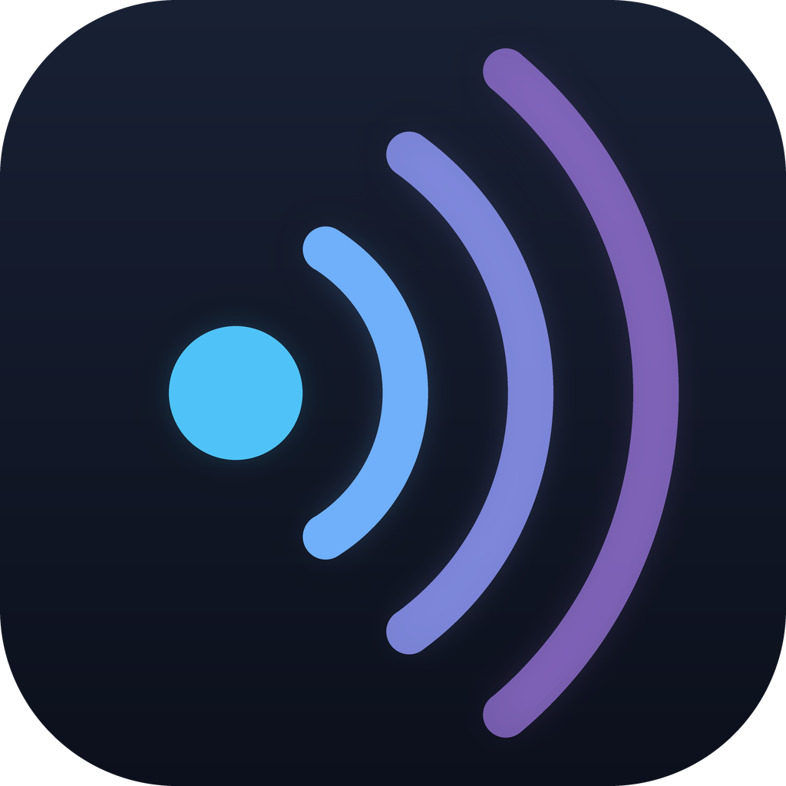

<p align="center"></p>

# Echora

Türkçe sesli komutlarla Windows'u yöneten, sistem tepsisinde yaşayan arka plan uygulaması. Bir komut
söylediğinizde ekranda seçtiğiniz efekt oynar ve eylem çalışır. Ses tanıma tamamen bu bilgisayarda
yapılır; ses hiçbir zaman diske yazılmaz ya da ağa gönderilmez. (Uygulamanın eski adı "Yankı"ydı.)

## İndirme ve kurulum

1. [Releases](https://github.com/knutolof06/echora/releases) sayfasından son sürümün
   `Echora-X.Y.Z-win64.zip` dosyasını indirin.
2. **Önce zip'i bir klasöre çıkarın:** zip'e sağ tıklayıp **Tümünü ayıkla** deyin. `echora.exe`'yi
   zip'in içinden (çıkarmadan) çalıştırmayın; DLL'ler ve tanıma modeli bulunamaz.
3. Çıkardığınız klasördeki `echora.exe`'ye çift tıklayın. Kurulum sihirbazı açılır:
   - dosyalar `%LOCALAPPDATA%\Programs\Echora` klasörüne kopyalanır (yönetici yetkisi gerekmez) ve
     Başlat menüsüne "Echora" ile "Echora Stüdyo" eklenir,
   - "Windows ile başlat" seçeneği (varsayılan açık),
   - mikrofon izni denetlenir; Windows'ta masaüstü uygulamalarının mikrofon erişimi kapalıysa
     Windows'un mikrofon ayar sayfası açılır (bu bir Windows gizlilik ayarıdır; Echora yalnız okur,
     değiştirmez),
   - isterseniz mikrofonu deneyebilirsiniz (canlı seviye çubuğu).
4. **Kur ve başlat**'a basın. Echora tepside başlar; zip'ten açtığınız klasörü silebilirsiniz.

**SmartScreen uyarısı:** Echora imzasız (kod imzalama sertifikası yok) olduğu için Windows ilk
açılışta "Windows bilgisayarınızı korudu" diyebilir. Bu imzasız uygulamalarda olağandır:
**Ek bilgi → Yine de çalıştır** ile geçilir. İndirdiğiniz zip'in özetini aynı sürümdeki
`SHA256SUMS.txt` ile karşılaştırabilirsiniz (PowerShell: `Get-FileHash .\Echora-X.Y.Z-win64.zip`).

Eski bir "Yankı" kurulumu varsa sihirbaz onu (çalışmıyorsa) kaldırır; ayarlarınız korunur ve ilk
açılışta yeni klasöre taşınır.

**Kaldırma:** tepsi menüsünden Çıkış, sonra `%LOCALAPPDATA%\Programs\Echora` klasörünü ve Başlat
menüsündeki "Echora" klasörünü silin; Stüdyo > Ayarlar'dan "Windows ile başlat"ı önce kapatın.
Ayarlar `%APPDATA%\Echora`'da kalır.

### Kaynaktan kurulum (geliştiriciler)

Gerekenler: Rust (`stable-x86_64-pc-windows-gnu`), MinGW-w64 (`gcc`, `windres`) ve `modeller/`
klasöründe Vosk Türkçe modeli ile Windows kütüphanesi (adresler ve özetler:
[modeller/OKU.md](modeller/OKU.md); `araclar\modelleri-indir.ps1` indirir ve SHA-256'yı doğrular).

```bash
powershell -ExecutionPolicy Bypass -File .\kur.ps1
```

Betik derler, `%LOCALAPPDATA%\Programs\Echora` klasörüne kopyalar ve Başlat menüsü kısayollarını
ekler. Kaldırmak için `.\kaldir.ps1` (ayarlarınız korunur; `-AyarlariSil` ile onlar da silinir).
Kurmadan denemek için: `cargo build --release` ve `target\release\echora.exe` (derleme klasöründen
çalışan exe kurulum sihirbazını açmaz ve güncellenmez).

Sürüm paketi: `araclar\paketle.ps1` → `dist\Echora-X.Y.Z-win64.zip` ve `dist\SHA256SUMS.txt`.

## Güncellemeler

- Echora açılıştan bir dakika sonra ve günde bir kez GitHub'daki son sürümü denetler (Stüdyo >
  Güncellemeler > "Otomatik denetle" ile kapatılabilir). Elle denetim: tepsi menüsünde
  **Güncellemeleri denetle** ya da Stüdyo'da **Şimdi denetle**.
- Yeni sürüm varsa arka planda indirilir, SHA-256 özeti doğrulanır ve açılır; bir kez
  "Echora X.Y.Z indirildi — kurmak için tıklayın" bildirimi gösterilir.
- **Kurulum her zaman onayınızı bekler:** bildirime tıklayın, tepsi menüsünde **Güncellemeyi kur**
  deyin ya da Stüdyo'daki düğmeyi kullanın; üçünde de Echora aynı onay penceresini açar. Kurulumdan
  hemen önce indirilen dosyanın özeti yeniden denetlenir. Stüdyo açıksa önce kapatılır (kaydedilmemiş
  değişiklik varsa kurulum başlamaz). Echora kapanır (kapatılan ekranlar önce açılır), yeni
  sürüm kurulur ve Echora yeniden açılır. Kurulum başarısız olursa eski sürüm yerinde kalır.
- Yalnız kurulu Echora (`%LOCALAPPDATA%\Programs\Echora`) güncellenir; derleme klasöründen çalışan
  geliştirme sürümü güncellenmez.
- Önsürümler (`-beta` vb.) otomatik güncelleme olarak sunulmaz.

**Güvenlik notu:** güncelleyici yalnız HTTPS ile ve yalnız `api.github.com`, `github.com`,
`objects.githubusercontent.com`, `release-assets.githubusercontent.com` adreslerine bağlanır
(yönlendirmeler dahil), boyut sınırları uygular ve zip'teki tehlikeli yolları (`..`, mutlak yol)
reddeder. SHA-256 özeti aynı GitHub sürümündeki `SHA256SUMS.txt`'den geldiği için yalnız
**bütünlüğü** (bozuk ya da yarım indirme) korur; dosyanın gerçekten bu projeden geldiğini GitHub
hesabının güvenliği belirler. Uygulama ve güncellemeler kod imzalı değildir; güvence GitHub hesabının
güvenliğidir.

## Kullanım

Echora başlayınca pencere açılmaz; saatin yanındaki tepside simgesi belirir (duraklatınca ve
mikrofon/model sorunu olduğunda simge değişir).

- **Sol tık:** dinlemeyi duraklatır / sürdürür (duraklatınca mikrofon tamamen serbest kalır).
- **Sağ tık:** Stüdyo'yu aç, Efektler (efektler açık / ipucu efektleri açık), ayar dosyasını aç,
  ayarları yeniden yükle, günlüğü aç, güncellemeleri denetle / güncellemeyi kur, çıkış.

### Tetik kelimesi

Geri dönüşü zahmetli komutlar (ekran kapatma, kilitleme, uyutma, uygulama kapatma, sahneler) ve tek
kelimelik komutlar yalnız tetik kelimesiyle çalışır: **"atlas ekranları kapat"**. Diğerleri doğrudan:
**"krom aç"**. Tetik kelimesi Stüdyo'dan değiştirilebilir.

Komuttan sonra yaklaşık yarım saniye susun; Echora konuşmanın bittiğini sessizlikten anlar.

### Varsayılan komutlar

| Söyleyin | Yapılan |
|---|---|
| atlas ekranları kapat / atlas hepsini kapat | Tüm ekranları kapatır |
| atlas ana ekranı kapat | Yalnız Windows'ta ana ayarlı ekranı kapatır |
| atlas sol / sağ / ikinci ekranı kapat | O ekranı kapatır |
| ekranları aç | Kapatılan ekranları açar |
| krom aç · not defteri aç · hesap makinesi aç · youtube aç | Uygulamayı açar |
| atlas krom kapat · krom öne getir | Uygulamayı kapatır / öne getirir |
| sesi yüzde elli yap | Ses düzeyini %50 yapar (0-100 arası her sayı) |
| sesi artır · sesi azalt / sesi kıs | Sesi 10 puan değiştirir |
| sessize al / sesi kapat · sesi aç | Sessize alır / açar |
| pencereyi indir · pencereyi tam ekran yap · pencereyi daralt | Ön penceredeki pencereyi küçültür / büyütür / geri yükler |
| pencereyi diğer ekrana taşı | Ön pencereyi sağdaki ekrana taşır |
| masaüstü göster | Masaüstünü gösterir |
| atlas bilgisayarı kitle · atlas bilgisayarı uyut | Oturumu kilitler / uyutur |
| müziği durdur / müziği oynat · sonraki şarkı · önceki şarkı | Medya tuşları |
| geri al | Son eylemi geri alır (son 10 eylem, 10 dakika) |
| atlas iş modu · atlas film modu · atlas gece modu | Sahne: sıralı eylemler |
| stüdyo aç / ayarları aç | Stüdyo'yu açar |
| atlas dinlemeyi durdur | Dinlemeyi duraklatır (yeniden başlatmak için tepsi simgesine tıklayın) |

**Sözlük kısıtı:** Tanıma modeli yalnız bildiği kelimeleri tanır. "chrome", "kilitle", "büyüt",
"küçült" gibi kelimeler modelde yoktur; bu yüzden komutlar "krom", "kitle", "indir" gibi modelin
bildiği kelimelerle yazılmıştır. Yeni bir ifade eklerken Stüdyo'daki **Sözlüğü denetle** düğmesini
kullanın.

## Stüdyo

Tepsi menüsünden, Başlat menüsündeki "Echora Stüdyo"dan ya da "stüdyo aç" diyerek açılır.

- **Komutlar:** ifadeler, eylemler, riskli işareti ve komut başına efekt. **Dene** düğmesi komutu
  çalışan Echora'ya gönderir (riskli komutlarda önce onay ister; kaydedilmemiş değişiklik varken kapalıdır).
- **Uygulamalar:** söyleniş (ör. "krom"), görünen ad, çalıştırılacak program.
- **Efektler:** 16 efektin canlı önizlemesi, renkler, süre, şiddet, hangi ekranda oynayacağı, sese
  tepki; efektleri ve ipucu efektlerini tamamen kapatma.
- **Olaylar:** "anlaşılmadı", "tetik gerekli", "hata" ve (varsayılan kapalı) "duyuldu" ipuçları.
- **Sahneler:** tek cümleyle çalışan eylem dizileri ve beklemeler.
- **Ayarlar:** tetik kelimesi, güven eşiği, mikrofon, sessiz saatler, ekran başına kapatma yöntemi,
  modelin bellekten bırakılma süresi, Windows ile başlat (yalnız kurulu sürümde).
- **Anlaşılmayanlar:** (varsayılan kapalı) açarsanız anlaşılmayan konuşmaların METNİ yalnız bu
  bilgisayarda saklanır ve buradan bir komuta eş anlamlı olarak eklenebilir.
- **Kurulum ve izinler:** kurulum konumu, Windows ile başlat, mikrofon izni ve mikrofon testi.
- **Güncellemeler:** sürüm, son denetim, durum, "Şimdi denetle", "Güncellemeyi kur", otomatik denetim.

İlk kayıtta özgün ayar dosyanız `ayarlar.toml.bak` olarak saklanır; Stüdyo kaydı dosyadaki açıklama
satırlarını yeniler. Tepsi menüsündeki efekt anahtarları da dosyayı Stüdyo kaydı gibi yazar (aynı
yedek kuralı; açıklama satırları yenilenir).

## Efektler

Nefes, Kenar Nabzı, Ses Dalgası, Tüp Kapanışı, Perde, Portal, Şok Dalgası, Sonar, Aurora, Kıvılcım,
Mürekkep, Yıldız Kayması, Kinetik Yazı, Harf Yağmuru, Bozulma, Tarama.

Ekranı kapatan, oturumu kilitleyen ve uyutan komutlarda efekt önce oynar, eylem efektin sonunda
çalışır. Efekt sürerken "ekranları aç", "geri al" ya da "dinlemeyi durdur" derseniz bekleyen eylem
iptal edilir. Efektler kapalıysa (tepsi menüsü > Efektler) hiçbir efekt oynamaz ve bu eylemler de
beklemeden hemen çalışır. Windows'ta "Animasyon efektlerini göster" kapalıysa tüm efektler sade
Nefes'e iner.

## Ekran kapatma

- **Tüm ekranlar:** Windows'un ekran kapatma iletisiyle; fareyi oynatmak ya da "ekranları aç" açar.
- **Tek ekran:** önce monitörün DDC/CI güç komutu denenir (gerçek kapatma); monitör desteklemiyorsa
  o ekranın üstüne siyah bir perde açılır (tıklayınca ya da bir tuşa basınca kalkar). Çalışan yöntem
  öğrenilir; Stüdyo'dan ekran başına sabitlenebilir.
- Echora bir ekranı kapattıktan sonra kapanır ya da çökerse, bir sonraki açılışta o ekranı geri açar.
  Son çare monitörün kendi güç düğmesidir.

## Kaynak kullanımı

Ölçülen değerler (3 monitörlü, 1920×1080 masaüstü):

| Durum | Bellek | CPU |
|---|---|---|
| Boşta, tanıma modeli yüklü değil | ~2-20 MB | ~%0 |
| Konuşma varken (model yüklü) | ~110-130 MB fiziksel, ~600-770 MB ayrılmış | ~%3 |
| Efekt oynarken | +~50 MB (2 sn sonra bırakılır) | GPU |

Tanıma modeli konuşma algılanınca yüklenir (~300 ms) ve 30 sn sessizlikten sonra bellekten bırakılır
(Stüdyo > Ayarlar'dan değiştirilebilir). Sürekli sesli bir odada model bellekte kalır.

Tam ekran bir uygulama (oyun, sunum) öndeyken ya da sessiz saatlerde konuşmalar yok sayılır.

## Gizlilik

- Ses diske yazılmaz ve ağa gönderilmez; tanıma bu bilgisayarda yapılır.
- **Ağ:** yalnız GitHub'dan güncelleme denetimi ve indirmesi (`api.github.com`, `github.com` ve
  GitHub'ın dosya sunucuları). İstekte kişisel bilgi yoktur (genel bir User-Agent:
  `Echora-Guncelleyici/<sürüm>`). Otomatik denetim Stüdyo > Güncellemeler'den kapatılabilir; kapalıyken
  Echora siz "Güncellemeleri denetle" demedikçe ağa bağlanmaz.
- Günlük (`%APPDATA%\Echora\echora.log`) yalnız çalışan komutları, güncelleme adımlarını ve hataları
  tutar; söylenen ama eşleşmeyen konuşmalar günlüğe yazılmaz.
- "Anlaşılmayanları kaydet" açıksa eşleşmeyen konuşmaların metni `%LOCALAPPDATA%\Echora\anlasilmayanlar.txt`
  dosyasında (son 50 satır) tutulur.
- Mikrofon gizlilik ayarı yalnız okunur; Echora Windows ayarlarını değiştirmez.

## Dosyalar

| Yol | İçerik |
|---|---|
| `%LOCALAPPDATA%\Programs\Echora\` | Kurulu uygulama (echora.exe, DLL'ler, tanıma modeli) |
| `%APPDATA%\Echora\ayarlar.toml` | Komutlar ve ayarlar (Stüdyo düzenler, elle de düzenlenebilir) |
| `%APPDATA%\Echora\echora.log` | Günlük (1 MB'ta döner) |
| `%LOCALAPPDATA%\Echora\` | Kapatılan ekran kurtarma kaydı, öğrenilen ekran yöntemleri, anlaşılmayanlar |
| `%LOCALAPPDATA%\Echora\guncelleme\` | İndirilen güncelleme ve `durum.json` (kurulumdan sonra temizlenir) |

## Geliştirme

```
crates/kulak      mikrofon yakalama (WASAPI) ve konuşma tespiti (WebRTC VAD)
crates/anlayici   Vosk sınırlı gramer tanıma
crates/komut      ayar şeması, şablonlar, eşleme, efekt türleri (saf, Win32 yok)
crates/eylemci    sistem eylemleri (ekran, ses, pencere, oturum, medya, uygulama)
crates/sahne      efekt motoru (D3D11 + DirectComposition, HLSL)
crates/studyo     ayar penceresi ve kurulum sihirbazı (egui)
uygulama/yanki    tepsi uygulaması ve güncelleyici (echora.exe)
araclar/olcum     ölçüm aracı (Faz 0)
araclar/*.ps1     paketleme, model indirme
```

Tasarım: [docs/superpowers/specs/2026-11-14-sesli-kontrol-design.md](docs/superpowers/specs/2026-11-14-sesli-kontrol-design.md).
`echora.exe --kuru` eylemleri çalıştırmadan yalnız günlüğe yazar (efektler yine oynar; güncelleyici
ağa çıkmaz). `echora.exe --surum` sürümü yazdırır.

Sürüm yayınlamak: `Cargo.toml`'daki `[workspace.package] version`'ı artırın, `SURUM-NOTLARI.md`'ye
`## vX.Y.Z` bölümü ekleyin, `vX.Y.Z` etiketini push'layın. GitHub Actions (`.github/workflows/surum.yml`)
derler, sınar, paketler ve Release'i oluşturur.
